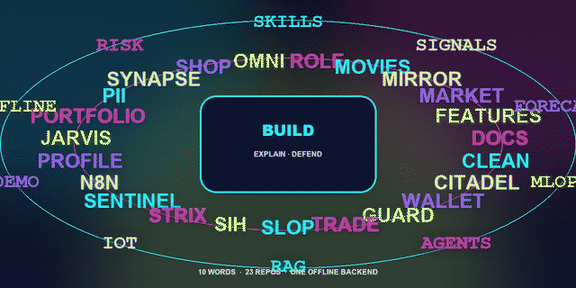
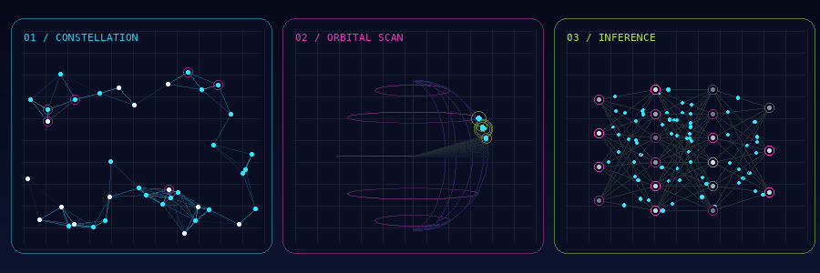

# AI/ML Project Portfolio

[](https://github.com/mayankjain1815-commits/ai-ml-portfolio/actions/workflows/tests.yml)

<p align="center">
  
</p>

> Eight self-contained AI/ML projects — complex enough to impress, simple enough to explain out loud in two minutes. Every project runs **fully offline in demo mode**; the Python projects upgrade to real LLM calls the moment a `GEMINI_API_KEY` is set.

Built from scratch (no langchain, no streamlit, no SDK wrappers) so every design decision is mine to explain and defend — the mechanics are the point.

### Under the hood

<p align="center">
  
</p>

| System | What it actually does |
|--------|-----------------------|
| **Particle constellation** | Depth-projected nodes with proximity links, front-layer glow and cursor parallax — O(n²) proximity pass on a 72-node field, no physics library. |
| **Threat globe** | A lat/lon wireframe sphere projected in software, rotating with a radar sweep and six pulsing sensor positions. |
| **Activation graph** | Signals travelling across weighted 4→6→6→3 layers with per-node activation pulses — the shape of every project in this repo. |

All three are hand-written canvas systems: no WebGL, no libraries, no external assets. The palette is **aurora neon** — obsidian navy `#060918` / `#0D1430`, electric cyan `#2DE7FF`, hot magenta `#FF42C6`, acid lime `#C4FF4D`, violet `#8E64FF` and ice white `#E9F2FF`.

The animated versions above are GIFs because GitHub strips `<script>` and `<canvas>` from Markdown. The real interactive versions — pointer parallax, offscreen pausing, reduced-motion support — live on the self-contained [landing page](index.html).

### Solar Atlas — the backend behind 33 worlds

The [landing page](index.html) is now a solar system. The **ten concept words** orbit as inner planets and **23 public repositories** orbit further out across eight wider bands. One deterministic star drives the whole layout: every orbit radius, period, inclination, eccentricity, texture, ring and moon count comes from the record slug. Click a planet in the canvas or a chip in the catalog and a detail panel opens with both the record and its measured orbital results. A read-only Flask API in [`backend/`](backend/README.md) owns every record; the page carries the same data as embedded JSON so it still works with the server off or on a static host.

```bash
cd backend && python -m venv .venv && .venv/bin/pip install -r requirements.txt
.venv/bin/python -m word_atlas           # http://127.0.0.1:5110
.venv/bin/python -m pytest -q            # 116 offline tests
curl -s http://127.0.0.1:5110/api/solar
curl -s http://127.0.0.1:5110/api/solar/words/rag
curl -s http://127.0.0.1:5110/api/solar/repos/omniroute
curl -s http://127.0.0.1:5110/api/stats
```

- **Planet records:** each world reports catalogue id, orbit band, orbit radius, period, diameter, inclination, eccentricity, texture, temperature, moons and ring tilt — deterministic UI metadata, explicitly labelled as not astronomy.
- **Word records:** definition, why it matters, pipeline, real code anchors, commands, interview answer, pitfalls, tests, related words and linked repos.
- **Repo records:** description, stack, highlights, GitHub URL, star/language snapshot, linked words, related repos, canvas systems and a clone command.
- **Search + stats:** `/api/search?q=` spans both classes; `/api/solar`, `/api/solar/stats`, `/api/stats`, `/api/timeline`, `/api/languages` and `/api/categories` power the stat strip, search and catalog.
- **One palette:** the old Christmas skin and snow effect are gone. `/api/themes` now serves only the aurora palette that drives the solar canvas and the three systems below.

CORS is open so the page works from `file://` too, and the embedded fallback renders instantly before any fetch resolves.

## The projects

| # | Project | What it is | Demo command |
|---|---------|------------|--------------|
| 01 | **Orbit Voice Assistant** | Voice-first browser assistant: Web Speech API frontend, rule-based NLU (intent → slots → tools), AST-safe calculator, persistent notes, app allowlist. ReAct tool loop over the same tools in LLM mode. Flask, port **5101**. | `python -m orbit_voice_assistant` |
| 02 | **Crew Engine** | A multi-agent framework from scratch: sequential, supervisor, and reflective crews sharing a blackboard (cited facts + artifacts + audit trace). Deterministic demo brains; JSON tool-calling loop with Gemini. 4-doc corpus included. | `python -m crew_engine demo --trace` |
| 03 | **RAG Studio** | Retrieval-augmented generation, hand-built: chunking, TF-IDF index, retrieval, generation, and an eval harness (recall@k, MRR, faithfulness). | `python -m rag_studio demo` |
| 04 | **Model Watch** | MLOps monitoring: population-stability-index and KS drift detection by hand, sliding-window alerts, model registry, training + simulation + dashboard (Flask, port **5104**) + CLI reports. | `python -m model_watch demo` |
| 05 | **Skill Forge** | An agent skill system: `SKILL.md` frontmatter + body parsing (a tiny YAML-ish subset, no PyYAML), a keyword selector plus an LLM router, token-budget prompt packing, and a CLI to list, search, pick, pack, run, and install skills. 9 bundled skills, 57 tests. | `python -m skill_forge demo` |
| 06 | **GH Activity Forge** | GitHub contribution-graph generator: seeded activity profiles (Poisson/streaks/vacations), a hand-built SVG renderer with GitHub's exact palette, report bundle, and an *opt-in, loudly-warned* fake-commit script emitter. | `python -m gh_activity_forge --year 2026` |
| 07 | **Disaster Watch** | Forecast-driven disaster monitoring: deterministic hourly forecasts, rule-weighted risk scoring (flood/cyclone/heat/storm), deduplicated alerts and an authority dashboard with JSON APIs (port **5107**). 5 tests. | `python -m disaster_watch demo` |
| 08 | **SENTINEL · IoT Command** | End-to-end early warning for a three-node ESP32/LoRa network: validated telemetry into `node:sqlite`, transparent 0–100 risk engine, alert escalation, WebSocket push, offline vector map, authority console, incident audit log. Node 22+, React 19, Vite 7. 38 tests. | `npm run dev` |

## The one idea that unifies them

**Demo mode is a parallel implementation, not a stub.** Every Python project ships a deterministic, rule-based brain that performs the *same pipeline* the LLM performs — real extraction, real rubric scoring, real retriever math — so the whole portfolio runs offline, in CI, and in a live demo with zero keys. Set a `GEMINI_API_KEY` in any Python project's `.env` and the same code upgrades to real model calls with an honest fallback. The two operations projects use seeded forecast / telemetry streams for the same reason: every number is reproducible. Ask any project what it would do with a key or a live feed and the answer is architectural, not aspirational.

## Repo layout

```
.
├── 01-orbit-voice-assistant/   Flask app + Web Speech frontend (port 5101)
├── 02-crew-engine/             multi-agent crews on a blackboard
├── 03-rag-studio/              RAG pipeline + eval harness
├── 04-model-watch/             drift detection + model registry (port 5104)
├── 05-skill-forge/             agent skill system
├── 06-gh-activity-forge/       contribution-graph generator
├── 07-disaster-watch/          forecast + risk scoring dashboard (port 5107)
├── 08-sentinel-iot/            ESP32/LoRa command platform (Node 22, ports 5108/5109)
├── backend/                    Flask atlas API + 116 offline tests
│   ├── sync_index.py            refreshes index.html's embedded JSON snapshots
│   └── word_atlas/
│       ├── data.py              source of truth for the 10 concept words
│       ├── repos.py             source of truth for the 23 repository worlds
│       ├── solar.py             deterministic 33-world layout and orbit stats
│       └── themes.py            the remaining aurora palette
├── .github/workflows/tests.yml CI: 8 Python suites (3.13) + SENTINEL tests/build (Node 22)
├── docs/
│   ├── BUILD_SPEC.md           shared conventions for projects 01–06
│   └── LEARNING_GUIDE.md       interview prep: Q&A per project
├── assets/                     animated GIF showcase rendered inline on GitHub
│   ├── portfolio-hero.gif       solar system: 33 textured worlds on 13 orbit bands
│   └── portfolio-systems.gif    three canvas systems (48 frames)
├── .venv/                      shared Python 3.13 environment (gitignored)
├── index.html                  solar canvas, catalog, detail panels, search and stats
└── README.md                   you are here
```

Each project is self-contained: its own `README.md`, `.env.example`, `.gitignore`, and `tests/` — no imports across projects. Projects 01–07 ship `requirements.txt` and share the root venv; project 08 is a Node app with its own `package.json` / `package-lock.json`.

```bash
# one venv for the Python projects
python3.13 -m venv .venv && .venv/bin/pip install -r 01-orbit-voice-assistant/requirements.txt

# tests for any Python project (all offline)
cd 01-orbit-voice-assistant && ../.venv/bin/python -m pytest -q
cd ../07-disaster-watch && ../.venv/bin/python -m pytest -q

# a live demo of any project (no API key needed)
cd ../02-crew-engine && ../.venv/bin/python -m crew_engine demo --trace
cd ../07-disaster-watch && ../.venv/bin/python -m disaster_watch demo

# the Node project (Node 22+)
cd ../08-sentinel-iot && npm ci && npm test && npm run dev
```

CI runs every suite on push/PR: eight Python suites on 3.13 (including the Solar Atlas backend's 116 tests) and SENTINEL's tests plus production build on Node 22.

## Interview framing

This portfolio is built to hold up in a technical interview. For every project: *what's the 2-minute story, which part was hardest, and where's the code that proves it.* The [learning guide](docs/LEARNING_GUIDE.md) contains the Q&A I rehearsed for each project, along with the follow-ups an interviewer is likely to ask.

## License & credit

Learning portfolio. All code, corpus articles, and data files are original or freely licensed (see each project's README). Inspired-by sources are credited per project — the point of a rebuild is that you understand what you ship.